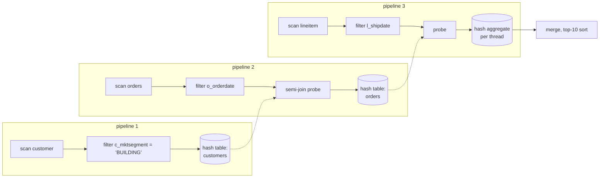

<div align="center">

# morsel

**A vectorized, columnar query engine in C++17: SIMD selection and arithmetic kernels with
runtime CPU dispatch, hash joins and hash aggregation, and morsel-driven parallel execution.
Eight TPC-H queries give exactly DuckDB's answers, and the engine is benchmarked against DuckDB
at scale factor 1.**

[](https://github.com/vik-bit/morsel/actions/workflows/ci.yml)


</div>

---

## At a glance

| | |
|---|---|
| **What it is** | An analytical query engine built the way DuckDB and HyPer are: data stored as typed column arrays, processed 2,048 values at a time through push-based pipelines, on every core at once. Query plans are written in C++ with a small plan-builder DSL (there is no SQL parser). |
| **What I built** | A binary column format and loader; AVX2 kernels for filters and int64 arithmetic, picked at runtime, with branch-free scalar fallbacks; vectorized expressions with exact decimal arithmetic; hash join (inner, semi, anti) and hash aggregation; sort and top-N; a morsel-driven scheduler that cuts plans into pipelines. About 4,700 lines of C++ with no dependencies. |
| **Correct** | **All 8 implemented TPC-H queries match DuckDB value by value** at SF 0.01 and SF 1, on 1 and 12 threads, with and without SIMD. Integers, decimals, dates and strings match exactly; the 13 floating-point values (averages, Q14's ratio) match to 1e-12 relative. |
| **Fast (measured, with caveats)** | At SF 1 on a laptop, morsel's median time is 1.1–22× lower than DuckDB's, depending on the query. **This does not make it a better engine than DuckDB.** My plans are hand-written, strings are stored as 1-byte dictionary codes, and there are no NULLs or overflow checks. [Details and caveats ↓](#results) |
| **Verified by** | 25 unit tests (SIMD vs scalar vs reference for every op and tail length; operators against naive reference implementations). They also pass under ASan + UBSan, under ThreadSanitizer, with clang, and on arm64 (scalar path). CI runs all of these plus the DuckDB answer check on every push. |
| **Skills shown** | C++17 · SIMD intrinsics (AVX2) · runtime CPU dispatch · vectorized execution · hash table design · lock-free parallel build · morsel-driven parallelism · exact decimal arithmetic · sanitizers · benchmark methodology |

---

## Results

### TPC-H scale factor 1 (6M lineitem rows), morsel vs DuckDB 1.5.6

Three separate benchmark processes. In each, every query ran 10 timed times per engine, with
the engines alternating, after one warm-up each. Cells show the range across the three runs of
each run's median, in milliseconds ([raw JSON](bench/results/sf1/), produced by
[`bench/run_bench.py`](bench/run_bench.py) and [`bench/summarize.py`](bench/summarize.py)).

| Query | What it stresses | morsel, 1 thread | DuckDB, 1 thread | morsel, 12 threads | DuckDB, 12 threads | DuckDB / morsel (12 thr.) |
|---|---|---|---|---|---|---|
| Q1 | expressions + 4-group aggregation over 98% of lineitem | 86–119 | 205–293 | 22.7–24.2 | 57.0–58.7 | 2.4–2.5× |
| Q3 | 3-table join, top-10 | 34–50 | 50–71 | 13.8–15.6 | 33.8–39.7 | 2.3–2.9× |
| Q5 | 6-table join, two-column join key | 42–48 | 55–61 | 15.8–17.3 | 34.3–35.7 | 2.0–2.2× |
| Q6 | selective conjunctive filter (2% pass) | 9.5–9.9 | 22.7–24.9 | 3.6–4.1 | 9.5–11.7 | 2.6–2.8× |
| Q12 | string IN-list, column-vs-column compares, join | 19.5–22.5 | 94–104 | 7.7–8.4 | 36.2–37.5 | 4.3–4.7× |
| Q14 | `LIKE 'PROMO%'`, join, CASE | 11.5–14.7 | 33.7–44.0 | 6.7–7.4 | 21.4–31.6 | 3.1–4.7× |
| Q18 | aggregation into 1.5M groups, semi join | 188–199 | 245–265 | 99–122 | 113–135 | 1.10–1.14× |
| Q19 | string filters on 6M rows, OR of conjunctions | 8.0–8.2 | 178–185 | 3.7–4.6 | 68–78 | 17–18× |

**Why morsel is faster here, and why that doesn't make it better than DuckDB:**
- **Low-cardinality strings are dictionary codes.** `l_shipmode`, `l_returnflag`, `p_type` and
  similar columns are stored as 1-byte codes into a sorted dictionary. A string predicate
  (`= 'AIR'`, `IN (...)`, `LIKE 'PROMO%'`) is evaluated once per distinct value when the plan is
  built, then becomes a 256-entry lookup on the codes. DuckDB's in-memory tables store these as
  full strings, which is the main reason for the large gaps on Q12 and Q19. DuckDB's plan for
  Q19 pushes the same `l_shipmode`/`l_shipinstruct` filters down that mine does, but compares
  strings on 6M rows to apply them.
- **The plans are written by hand,** with join order, build sides and projections chosen
  knowing the data. DuckDB parses SQL and optimizes it, which costs time (about 0.45 ms for a
  trivial query through the Python API, included in its times) and does not always find the
  best plan. For Q19 I also pre-filter `part` with the single-table half of each OR branch.
- **morsel does less work per value.** There are no NULLs, no overflow checks on decimal
  arithmetic, and only 8 queries to support. DuckDB handles all of SQL.
- **Q18 is the fairest comparison, and it is close (1.1×).** It is dominated by hash
  aggregation into 1.5M groups, where neither engine gets help from strings or plan choice.

**How to read this:**
- Laptop: Intel i7-1255U (2 performance + 8 efficiency cores, 12 threads), WSL2, 7.6 GiB RAM.
  Clock speeds vary run to run. The single-thread ranges for Q1 and Q3 are ±20%, so treat
  differences under about 1.3× as unmeasured.
- Both engines hold all data in memory before timing starts. DuckDB's time is
  `execute(sql).fetchall()` from Python (parse, optimize, execute, fetch). morsel's time is
  plan binding plus execution, measured inside the process.
- Scale factor 10 was not run: DuckDB's in-memory copy alone would not fit in this machine's memory.

### What SIMD buys (1 thread, AVX2 kernels vs the scalar fallback)

| Query | AVX2 | scalar | scalar / AVX2 |
|---|---|---|---|
| Q6 | 9.5–9.9 ms | 12.0–12.8 ms | 1.24–1.35× |
| Q19 | 8.0–8.2 ms | 9.5–10.6 ms | 1.18–1.29× |
| Q12 | 19.5–22.5 ms | 22.7–25.4 ms | 1.09–1.16× |
| Q1, Q3, Q5, Q14, Q18 | | | 0.93–1.17×: within noise |

SIMD helps queries that are mostly filtering, and only by 10–35%. The scalar fallback is already
branch-free (it writes every position and advances the output index by the comparison result),
so it never mispredicts, and the remaining gap is vector width. Queries dominated by hash
tables (Q1's aggregation, joins, Q18) spend their time on memory access, which SIMD does not
touch. Full tables are in [bench/results/sf1/summary.md](bench/results/sf1/summary.md).

### Thread scaling, 1 → 12 threads

morsel speeds up 3.8–4.9× on Q1 and 2.3–3.2× on the join queries, about the same as DuckDB
(3.6–5.1× on Q1). Scaling is far below 12× for both engines: only 2 of the 10 cores are
performance cores, the laptop lowers its clock as more cores load up, and 12 hardware threads
share 2 + 8 physical cores. Q18 scales worst (1.5–2.0×), because its partitioned merge re-inserts
every one of the 1.5M groups. See the roadmap.

---

## What the benchmarks caught

**A 2× speedup that was mostly noise.** Q18's aggregation took ~340 ms. I changed the hash
table so each slot carries 32 hash bits as a tag (a probe that lands on another group is
rejected without touching that group), and so a group's key sits in the same row as its
aggregate states. One before/after pair showed 400 ms → 170 ms. When I alternated the old and
new binaries 15 times ([`bench/ab_compare.py`](bench/ab_compare.py)), the medians were
**246 ms → 196 ms: a real 20%, not 2×**. Single runs of the *same* binary ranged from 213 to
379 ms. Every performance claim in this README comes from alternating, repeated runs for this reason.

**An optimization that did nothing.** lineitem is stored in `l_orderkey` order, so I tried
reusing the previous row's group when keys repeat. Measured the same way: 0.97×, within noise.
The repeated keys were already hitting a cached slot, so I removed the change.

**Run-to-run drift.** Alternating the engines inside each run keeps the morsel/DuckDB ratio
steady (Q1: 2.38–2.53× across runs) even when absolute times move ±20% between runs.

---

## How it works



*TPC-H Q3 as morsel runs it. Hash-join builds and aggregations are pipeline breakers. Each
pipeline runs on all workers: a worker takes the next morsel (32K rows) from a shared atomic
counter and pushes it through the operators 2,048 rows at a time, into its own thread-local
sink. When the source is exhausted, the sink merges the local states.*

The same plan in C++ ([`src/tpch.cpp`](src/tpch.cpp)):

```cpp
Plan customers = Plan::scan(db, "customer", {"c_custkey", "c_mktsegment"})
                     .filter(col("c_mktsegment") == str("BUILDING"))
                     .select({"c_custkey"});
Plan orders = Plan::scan(db, "orders", {"o_orderkey", "o_custkey", "o_orderdate", "o_shippriority"})
                  .filter(col("o_orderdate") < date("1995-03-15"))
                  .join(customers, {"o_custkey"}, {"c_custkey"}, JoinType::Semi)
                  .select({"o_orderkey", "o_orderdate", "o_shippriority"});
Plan q3 = Plan::scan(db, "lineitem", {"l_orderkey", "l_extendedprice", "l_discount", "l_shipdate"})
              .filter(col("l_shipdate") > date("1995-03-15"))
              .select({"l_orderkey", "l_extendedprice", "l_discount"})
              .join(orders, {"l_orderkey"}, {"o_orderkey"})
              .aggregate({"l_orderkey", "o_orderdate", "o_shippriority"},
                         {sum(col("l_extendedprice") * (1 - col("l_discount")), "revenue")})
              .order_by({desc("revenue"), asc("o_orderdate")}, 10);
```

| Design decision | Why |
|---|---|
| Vectors of 2,048 rows, with a selection vector instead of copying survivors | A few columns of one vector fit in L1/L2. Filters only shrink the list of live positions; values are gathered once, when a join or sink needs them. |
| AVX2 selection by compare → `movemask` → permute from a 256-entry table | AVX2 has no compress instruction (AVX-512's `vpcompressd`), so a lookup table of permutations packs the passing positions of 8 lanes in one shuffle. Refining an existing selection uses gathers. |
| Kernels compiled with `__attribute__((target("avx2")))` and picked at runtime | One baseline x86-64 binary uses AVX2 where the CPU has it and the scalar code elsewhere (the same scheme as my [vecdex](https://github.com/vik-bit/vecdex)). Tests check both against a reference. |
| 64-bit multiply built from three 32×32 multiplies | AVX2 lacks `vpmullq`. Decimal arithmetic needs exact int64 products, so the kernel computes the low 64 bits, matching wrap-around scalar code bit for bit. |
| Dense or sparse evaluation chosen per vector | When at least 25% of rows are alive, expressions run over the whole vector (SIMD, no indirection); below that, only the selected positions are computed. |
| Decimals as scaled int64, sums as int128 | Results are exact, which is what lets the correctness test demand exact equality with DuckDB. Scales are aligned at bind time (`1 - l_discount` becomes `100 - x`). |
| Low-cardinality strings as sorted 1-byte dictionaries | Code order equals string order, so sorting and comparisons work on codes, and every string predicate becomes a per-code lookup table. |
| Join and group keys packed into one or two 64-bit words | Any mix of int32, date, int64 and dictionary key columns compares and hashes as one or two integers. |
| Join build: chained table, inserted with `atomic::exchange` | All workers insert at once without locks. Probes hash and prefetch a whole vector of buckets first, so cache misses overlap. |
| Aggregation: thread-local tables, then merge by hash partition | No synchronization while aggregating. 64 partitions are merged in parallel (above 16K groups); tiny results merge on one thread. |
| Slot = group index + 32-bit hash tag; key stored with the states | A probe that lands on another group is rejected from the slot alone. A hit costs one slot access and one row access. Measured 20% faster on Q18. |
| Morsels of 32K rows from an atomic counter | Workers that finish early take more morsels, so load stays balanced with no up-front partitioning. |

---

## Build, test, run

Linux or macOS with a C++17 compiler and CMake 3.18+. On Windows, use WSL.

```bash
cmake -S . -B build -DCMAKE_BUILD_TYPE=Release && cmake --build build --parallel
```
```bash
ctest --test-dir build --output-on-failure
```

Generate TPC-H data (DuckDB's dbgen, written to morsel's column format plus a DuckDB copy):

```bash
pip install -r requirements.txt
```
```bash
python scripts/gen_tpch.py --sf 1 --out data/sf1
```

Run queries, print the plan, and show per-pipeline times:

```bash
build/morsel run data/sf1 3 --threads 4 --explain --profile
```

Check every answer against DuckDB, then benchmark:

```bash
python tests/check_tpch.py --morsel build/morsel --data data/sf1 --threads 1 12 --scalar
```
```bash
python bench/run_bench.py --morsel build/morsel --data data/sf1 --reps 10 --scalar --out bench/results/sf1/run1.json
```

**Tests.** The 25 unit tests cover:
- Every SIMD kernel against the scalar kernel and a reference, for all six comparison ops, at
  every length from 0 to 70 plus full vectors, and with selections of three densities,
  including in-place refinement.
- The emulated 64-bit multiply, on random full-range operands including overflow.
- Every predicate kind (decimal literals with more digits than the column, dictionary and plain
  strings, `LIKE`, `IN`, `OR`, column-vs-column) against direct evaluation.
- Decimal scale alignment, joins with duplicate and missing keys, semi and anti joins, composite
  keys, the partitioned aggregation merge, sort with ties and limits, and identical results
  across thread counts and with SIMD off.

They pass under AddressSanitizer + UBSan and ThreadSanitizer, with GCC 11 and Clang 17.

---

## Limitations

- **No SQL.** Queries are C++ plans, and join order and pushdown are mine, not an optimizer's.
- **No NULLs**, no overflow detection in int64 arithmetic (int128 sums cannot overflow), no
  int128 arithmetic inside vectors (only in final projections, through double).
- **In memory only**, no spilling: hash tables must fit in RAM, and a join's build side is
  limited to 2³² rows.
- **Strings:** dictionary encoding needs at most 256 distinct values per column; other string
  columns are plain, can't be join or group keys, and are filtered row by row.
- **Q18 scales poorly** across threads (1.5–2.0×), because its 1.5M groups are hashed twice:
  once locally, once in the merge.
- **Measured on one laptop**, at SF 1 only. The comparison with DuckDB carries the caveats above.

## Roadmap

- Partition aggregation tables from the start (radix-partitioned local tables), so the merge
  stops re-inserting every group. This is the known fix for Q18's scaling.
- A minimal SQL front end (SELECT-FROM-WHERE-GROUP BY) that lowers to the plan builder.
- Bloom filters in front of join probes, and a cost-based join order.
- Lightweight compression (frame-of-reference, bit packing) with predicates evaluated on
  compressed data.
- SF 10 on a desktop or server with fixed clocks, profiled with `perf` hardware counters.

## License

MIT
